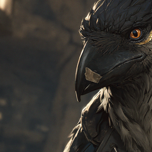
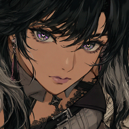

A record of our campaign in **Amphoreus**, a dying land of twelve Titans, where the Chrysos Heirs chase the coreflames to hold back the Black Tide.

> [!tip] Latest session
> [[Journal/Act 1 - A New Venture on the Eighth Dawn/Arc 6/Session 38 - Return to Tartarus|Session 38: Return to Tartarus]] · 11/10/26
> 
> [[Journal/index|Read the whole journal →]]

> [!calendar] Today in Amphoreus
> **Eosdas, 1 Month of Everday, 4931** · [[Calendar|Open the Light Calendar →]]

## The Party

<a class="party-card internal" href="Party/Caledor">Caledor</a><a class="party-card internal" href="Party/Delmore">Delmore</a><a class="party-card internal" href="Party/Franzen-Bonotelli">Franzen Bonotelli</a><a class="party-card internal" href="Party/Kenkai-Ventura">Kenkai Ventura</a><a class="party-card internal" href="Party/Mayuri">Mayuri</a><a class="party-card internal" href="Party/Sir-Caerwyn-Kyrn">Sir Caerwyn Kyrn</a><a class="party-card internal" href="Party/Yuichi-Highrose">Yuichi Highrose</a><a class="party-card internal" href="Party/Zuzros-Rhiesis">Zuzros Rhiesis</a>

[[Party/index|Skill points, paragon skills and former members →]]

## Quests

- [[Party Quests]]: the Flame-Chase, the Descent Beneath the Temple, and the party's open leads.

## The World

- **Places:** [[Amphoreus Info|Amphoreus]] · [[Okhema Info And Occupants|Okhema]] · [[Janusopolis Info and Occupants|Janusopolis]] · [[Philoxenion]]
- **Chrysos Heirs:** [[Aglaea]] · [[Anaxagoras]] · [[Castorice]] · [[Cerydra]] · [[Cipher]] · [[Hyacinthia]] · [[Hysilens]] · [[Mydeimos]] · [[Phainon]] · [[Terravox]] · [[Tribios]]
- **Titans:** [[Cerces]] · [[Georios]] · [[Janus]] · [[Kephale]] · [[Talanton]]
- **Skyfire Dragons:** [[Commander Deva]] · [[Ione Kalyx]] · [[Jossum]]
- **Reference:** [[Calendar|The Light Calendar]] · [[A_Travelers_Guide_to_the_Light_Calendar|A Traveler's Guide to the Light Calendar]]
